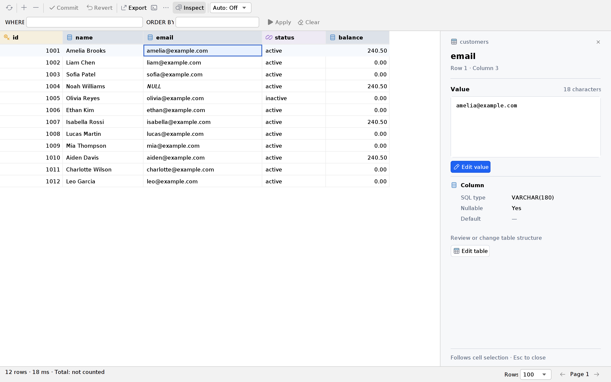
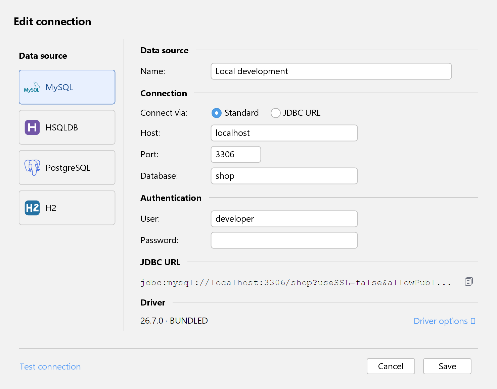
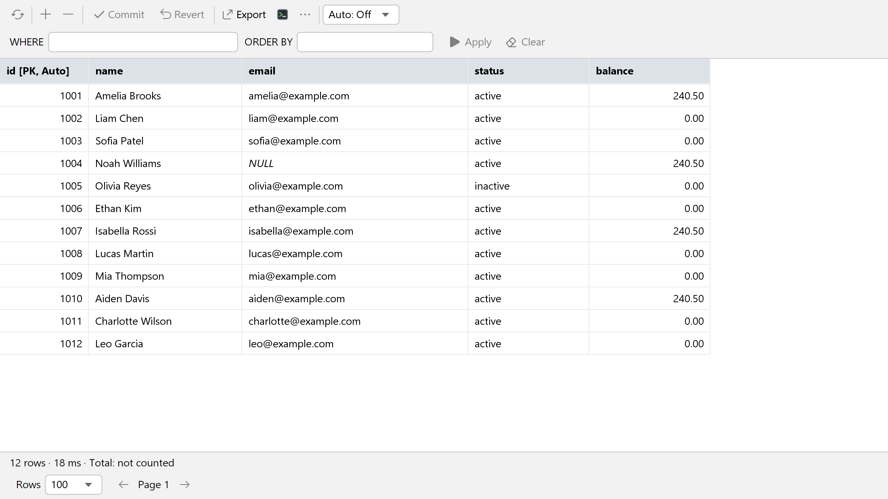
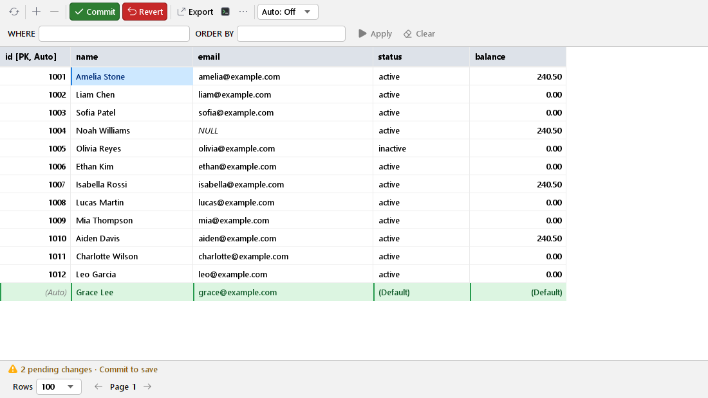
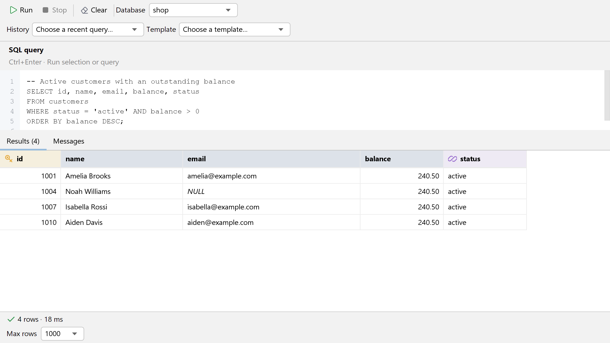

# Lattice


[](https://plugins.jetbrains.com/plugin/34772)
[](https://plugins.jetbrains.com/plugin/34772)
[](https://plugins.jetbrains.com/plugin/34772)
[](https://plugins.jetbrains.com/plugin/34772)

Lattice is a database management plugin for IntelliJ IDEA. Connect to MySQL, HSQLDB, PostgreSQL or H2, browse schemas, run SQL, edit table data, design tables and export results from your IDE.

Built with help from **Gemini 3.8**, **GPT-6 Luna** and **GPT-6.1 Sol**.

## Features

- Explorer for schemas, tables, views, columns and primary keys.
- SQL console with results, history, row limits, timeouts and cancellation.
- Editable table grids with pagination, filtering, batch saves, explicit NULL/default values and draft recovery.
- Create/alter table dialogs and database/schema maintenance.
- CSV, JSON, SQL INSERT and CREATE TABLE exports.
- JDBC driver selection: bundled release, verified download from Maven Central, or local JAR.
- Server and driver version information through **Test Connection**.
- Passwords and custom JDBC URLs stored through IntelliJ PasswordSafe.

## 0.0.2-alpha highlights

- **JDBC drivers:** Reuse verified downloads across IDE restarts, discover Maven-cached drivers and project defaults, and report missing or corrupt drivers. Discovery runs in the background and preserves manual selections.
- **UI and themes:** Native toolbars, compact connection forms, responsive filters and schema dialogs, improved light/dark palettes, clearer loading feedback and refreshed previews. Disabled icons match labels; mouse clicks no longer leave focus outlines, while keyboard focus stays visible.
- **Tables and SQL:** State-aware row, export, Apply, Run and Clear actions; Clear for table filters; headers bounded to columns; typed edit validation and editable auto-generated columns. Cancellation has neutral feedback, and session changes retire old connections.
- **Development tools:** Shared dependency reuse and cleanup, tracked child processes, portable Windows MySQL fixtures, local IDE deployment, and consolidated Linux/Windows commands and documentation.
- **Build and validation:** Updated Gradle, IntelliJ build tooling, JDBC drivers and protobuf runtime; migrated the Java namespace to `com.segfault03`. Cross-platform CI now includes production Swing assertions, real-IDE theme/action reviews and compatibility checks against the PR merge build.
- **Releases:** Signed ZIPs with verified signatures, formatted What's New notes, and automatic publication to GitHub and submission to JetBrains Marketplace after validation.

See the [changelog](docs/CHANGELOG.md) and [commits since the last release](https://github.com/SegFault03/Lattice/compare/v0.0.1-alpha...main) for details.

## Screenshots

Previews use sample data. These five screens are the featured UI previews.

### Side panel



### Connection dialog



### Table view



### Editing a table



### SQL console



## Requirements and compatibility

IntelliJ IDEA **2025.1 or later**, Community or Ultimate/unified editions, using the IDE's Java 21+ runtime. Windows, Linux and macOS are intended targets; hosted checks cover all three platforms. Real-IDE UI testing is available through the scripts below.

| Database | Server releases exercised |
|---|---|
| MySQL | 5.5.62, 5.6.51, 5.7.44 and 8.4.2 |
| HSQLDB | 2.2.9 through 2.7.4; file, memory and server modes |
| H2 | 2.3.232; embedded memory/file workflows (TCP form available; server compatibility review pending) |
| PostgreSQL | 8.4 through 18; select a Java 8 compatible pgJDBC (42.7.3 or 42.2.27 for servers older than 9.1) |

Choose a JDBC driver compatible with your server. HSQLDB requires a matching server/file format; some releases offer a `-jdk8` classifier. Java 8 support applies to JDBC drivers and the HSQLDB server runtime; MySQL and PostgreSQL are native servers. The plugin requires Java 21. See the [compatibility report](docs/compatibility.md) for tested combinations and limits.

## Install and connect

### From JetBrains Marketplace (Recommended)
1. Open IntelliJ IDEA, go to **Settings → Plugins**.
2. Select the **Marketplace** tab, search for **Lattice**, and click **Install**.
   *(Direct link: [JetBrains Marketplace — Lattice](https://plugins.jetbrains.com/plugin/34772))*.

### From Disk (Offline / Release ZIP)
1. Download `Lattice-<version>.zip` from this repository's GitHub Releases.
2. Open **Settings → Plugins → gear menu → Install Plugin from Disk** in IntelliJ.
3. Select the ZIP and restart if prompted.
4. Open the **Lattice** tool window and add a data source.

Select MySQL, HSQLDB, PostgreSQL or H2, enter connection details, and choose a driver:

- **Bundled driver**: the plugin includes Connector/J 26.7.0, HSQLDB 2.7.4, pgJDBC 42.7.14 and H2 2.3.232, plus every version you have downloaded. Pick one from the list to reuse it without downloading again.
- **Download a version**: choose or enter a version and click **Download**. Downloads are explicit and checksum-verified, and a release is fetched at most once. Afterwards it appears in the bundled list.
- **Local JAR**: select an existing JDBC driver.

**Test Connection** reports the server product/version after authentication and the driver's version. Failed authentication or negotiation can prevent detection. Downloaded drivers are kept in the IDE system cache and are reused across restarts.

For H2, select Memory for a named database that lasts until its last connection closes, File for a persistent database path, or Server for TCP (default port 9092). File mode accepts the database base path or an existing `.mv.db` file. The bundled driver is H2 2.3.232; custom URLs preserve options such as `IFEXISTS` and SSL settings. H2 1.x file migration and compatibility modes have not been validated. H2 DDL can commit an open transaction, so finish console transactions before schema changes.

Generated MySQL URLs currently disable TLS and use UTC for the driver/server session. For remote or TLS-required servers, use a custom JDBC URL with your required security options. Custom URLs retain your options.

## Build from source

Install **JDK 21**, then clone this repository. The Gradle wrapper downloads the pinned Gradle distribution, IntelliJ SDK and dependencies; a preinstalled IntelliJ or database is not required for ordinary builds and pure tests.

Linux/macOS:

```bash
./gradlew test buildPlugin
```

Windows:

```powershell
.\gradlew.bat test buildPlugin
```

The ZIP is written to `build/distributions/`. The default version comes from `gradle.properties`; `-PreleaseVersion=1.0.1` overrides it. An optional `-Plattice.ide.home=/path/to/idea-2025.1` uses your own SDK.

For a common command on all three platforms, install Python 3.11+ and run:

```text
python scripts/test.py --build
python -m unittest discover -s scripts/tests -v
```

Use `python3` if that is your system's Python command. All optional development/release helpers live in `scripts/`; see the [script reference](docs/SCRIPTS.md). Only the conventional Gradle launchers remain in the repository root.

### Quick local UI testing

To render the five featured production Swing screens in light mode, run `python scripts/ui-preview.py` with optional JDK 21 and IntelliJ SDK paths (missing inputs are downloaded), then open `build/ui-preview/index.html`. It uses a headless IntelliJ test application for platform services without opening an IDE window. Pass `--all-previews` for the light/dark gallery. The five README images in `screenshots/` are refreshed by default; review them and commit them with UI changes. See [UI previews](docs/UI_PREVIEW.md) for setup and the full-IDE capture commands.

To run the tooling and pure Java tests, build the ZIP, find an installed IntelliJ IDEA, and deploy the freshly built plugin:

```text
python scripts/dev-deploy.py
```

The cross-platform helper shows each step in the terminal. It prefers a running IDEA installation, validates the archive, replaces only Lattice, and restarts the selected IDE if it was running. A closed IDE stays closed. Save your IDE work first and respond to any exit prompts; the helper waits for shutdown and never force-kills the process. On Linux it uses `wmctrl` if available, otherwise SIGTERM.

Use `--dry-run` to inspect the target without making changes, `--list-ides` to list installations, or `--ide-home`, `--plugins-dir` and `--java-home` for explicit paths. Java 21 and an installed IDEA 2025.1+ are required; Gradle still compiles against the pinned 2025.1 SDK. See the [deployment helper reference](docs/SCRIPTS.md#quick-local-ide-deployment) for discovery, recovery, custom profiles and restart options.

## Validation

On Linux or Windows, run the full disposable validation flow with [the one-shot validation runner](scripts/one-shot-test.py), Python 3.11+ (Linux uses Docker; Windows uses native MySQL ZIP fixtures):

```text
python scripts/one-shot-test.py
```

The default run builds and tests the plugin, checks the ZIP, runs live database functional tests (including PostgreSQL on Linux), verifies IntelliJ 2025.1–2025.3, and exercises the complete JDBC/Java 8 matrix. It does not render screenshots; use `python scripts/ui-preview.py` for standalone Swing previews or `./scripts/linux/review-intellij-ui.sh` on Linux/X11 and `.\scripts\windows\review-intellij-ui.ps1` on Windows for real-IDE UI flows.

Use `--skip-compatibility` for the build and live functional checks, `--compatibility-only` for the IDE and JDBC matrices, or `--database-compatibility-only` for just the JDBC matrix when Plugin Verifier runs separately. Actions uses the isolated compatibility modes only for PRs targeting `staging` or `main`; routine checks use the Gradle cache.

The runner uses temporary Gradle, verifier and JDBC caches. It uses an installed JDK 21 or downloads one, and downloads a temporary Java 8 runtime when needed. Network access for missing dependencies and at least 10 GiB of download space are required; Linux fixtures also require Docker.

Ports 3306 and 9001 are used by the base functional checks, 3306 by the database matrix, and 19020–19029 by Plugin Verifier. A failure exits nonzero, preserves command logs and a failure summary in `build/one-shot-test/`, and removes owned tools and caches by default. Use `--download-dir`, `--binaries-dir`, explicit binary paths and `--no-cleanup` for reusable local assets. Every Python CLI has a matching PowerShell launcher under `scripts/windows/`; see [Windows commands and options](docs/WINDOWS_SCRIPTS.md) and [dependency options](docs/SCRIPTS.md#binary-paths-downloads-and-cleanup).

Use `--java-home` to select a full JDK 21 explicitly. For a shorter check against disposable MySQL 8.4/HSQLDB fixtures, see [the functional test guide](docs/CONTRIBUTING.md). The lower-level `scripts/test.py` runner remains available for focused build and fixture tests.

## Project layout

| Location | Contents |
|---|---|
| `src/` | Plugin source, resources and Java tests |
| [docs/](docs/README.md) | Development, release, support and compatibility guides |
| `scripts/` | Portable development and release helpers; tooling tests in `scripts/tests/` |
| `.github/` | GitHub issue forms, pull request template and workflows |
| `assets/`, `licenses/` | Branding and dependency license texts |
| `build/` | Ignored generated output, distribution ZIPs and validation reports |
| `screenshots/` | The five tracked README preview images |

Legacy workstation helpers are preserved outside the repository; private notes remain in ignored `docs/local/`. README, LICENSE, agent instructions and the Gradle wrapper launchers retain their root entry points. The five README screenshots are the only tracked generated artifacts.

## Releases and support

Every branch push runs cross-platform build/unit checks and Linux live functional, regression, integration and real-IDE UI checks (HSQLDB and PostgreSQL). PR merge commits receive these checks too. Database/Java 8 and IntelliJ 2025.1–2025.3 compatibility matrices run only for PRs targeting `staging` or `main`.

A new tag such as `v0.0.2-alpha` triggers the [release workflow](.github/workflows/release.yml) only after its commit is verified as reachable from `main`. Tags have no branch of their own; a tag on an unmerged feature commit is rejected before any build, signing or publication job. The tag pipeline runs release build/live/UI checks, ZIP validation, signing and signature verification, then publishes a GitHub Release and submits the same signed ZIP to JetBrains Marketplace. Compatibility matrices are confined to PRs. GitHub Releases include patch notes, commit history, checksums and corresponding MySQL sources. Prereleases are not designated latest; Marketplace submissions use the public Stable channel and become available after JetBrains approval. There is no manual release trigger; use the local dry-run commands in [Releasing](docs/RELEASING.md).

See [CHANGELOG](docs/CHANGELOG.md), [RELEASING](docs/RELEASING.md), [Marketplace publishing](docs/MARKETPLACE.md), [issue reporting](docs/ISSUE.md) and [security reporting](docs/SECURITY.md).

## Roadmap

Planned work includes:

1. Broader database compatibility coverage and support for more relational databases.
2. More SQL and schema actions, including generating POJOs, DTOs and JavaBeans from tables and query results.
3. SQL syntax highlighting and inline suggestions informed by connected database schemas, subject to feasibility within the IntelliJ Platform.
4. Relationship graphs and dependency trees to explore how tables connect through foreign keys.

More improvements are planned as Lattice evolves. These features are not available yet, and priorities may change based on feedback and technical feasibility.

## Known limits

HSQLDB multi-statement DDL is not atomic. Stable pagination without a primary key requires an explicit unique order. Partial CREATE reconstruction is labeled when native SCRIPT is unavailable. Connection failure during commit can leave an uncertain server outcome; verify persisted state before retrying. Dynamic plugin unload and project-close behavior are not covered by the UI suite.

## License

Lattice source is [MIT licensed](LICENSE). Bundled libraries retain their licenses; see [third-party notices](docs/THIRD_PARTY_NOTICES.md).
