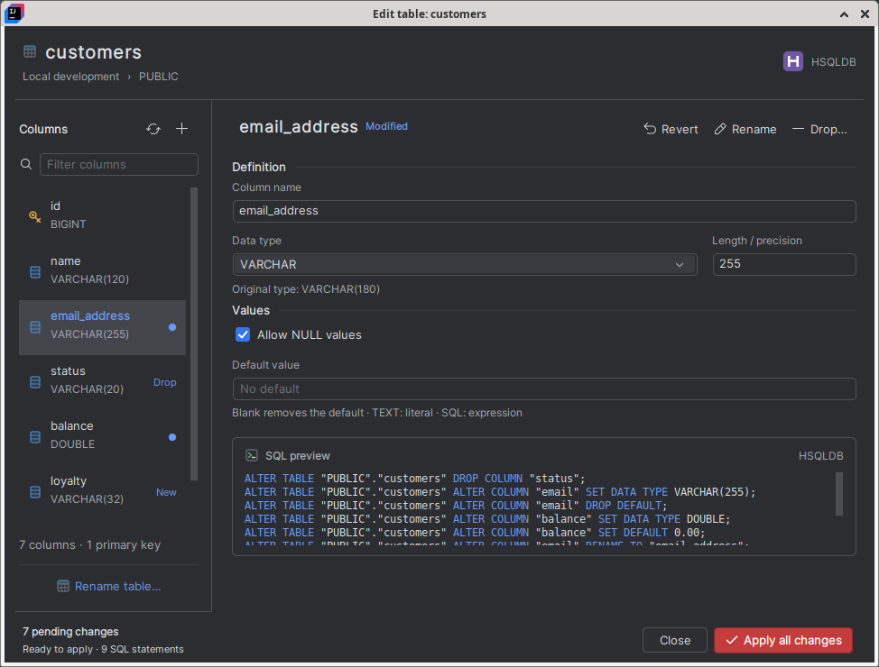

# Column Inspector · implemented design

These are desktop captures of the production Swing dialog running in IntelliJ
IDEA Community 2025.1 with the installed Lattice plugin. The dialog images are
crops of the live modal window. No replacement look and feel is used.

| Theme | Dialog | IntelliJ context |
| --- | --- | --- |
| Dark | [Open dialog](dark-dialog.png) | [Full IDE](dark-intellij.png) |
| Light | [Open dialog](light-dialog.png) | [Full IDE](light-intellij.png) |

## Functionality

- Filter and select columns; inspect type, length/precision, nullability and defaults.
- Add, modify, rename or drop a column; rename the table.
- Review database-specific SQL for all staged changes before applying the batch.
- Keep drafts across navigation, revert individual columns, validate the whole batch and confirm destructive actions.
- Prepare SQL and run database operations in the background with busy feedback.
- Retain remaining drafts after a partial failure without replaying successful steps; refresh the explorer after success.

See [UI preview instructions](../../../docs/UI_PREVIEW.md#column-inspector) to
See [UI preview instructions](../../../docs/UI_PREVIEW.md#column-inspector) for
the current interaction model and repeatable native review steps. PostgreSQL
batches use one transaction; MySQL, HSQLDB and H2 may commit DDL incrementally.
After a partial failure, the dialog reloads metadata and retains the remaining
edits. Rename cycles require an intermediate name in a separate Apply.
