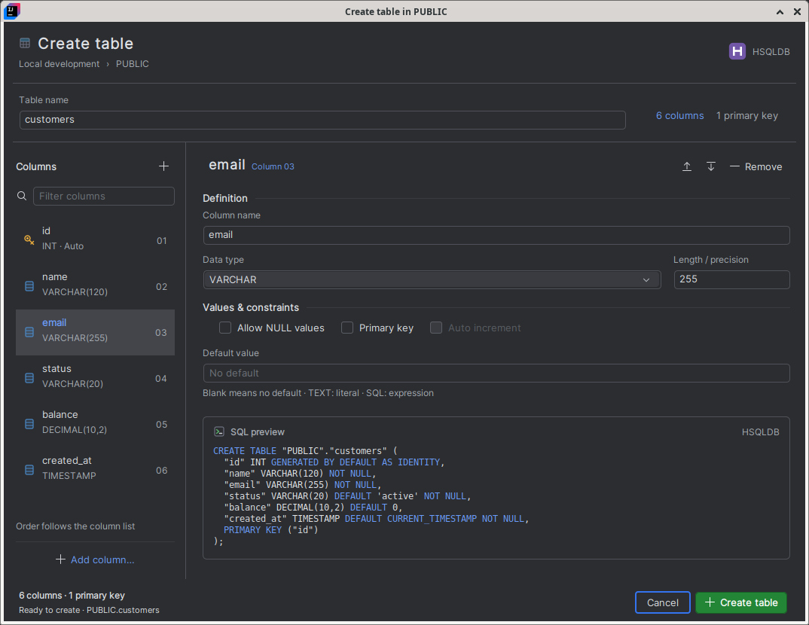

# Column Composer · implemented design

The create-table dialog now uses concept 01. These are actual desktop captures
of the production Swing dialog in IntelliJ IDEA Community 2025.1, with the
installed Lattice plugin. Dialog images are crops of the live modal window.

| Theme | Dialog | IntelliJ context |
| --- | --- | --- |
| Dark | [Open dialog](dark-dialog.png) | [Full IDE](dark-intellij.png) |
| Light | [Open dialog](light-dialog.png) | [Full IDE](light-intellij.png) |

The navigator retains all column drafts while switching and filtering. Add,
remove and reorder columns; edit names, types, lengths/precision, nullability,
primary keys, identity and defaults. The complete, provider-specific CREATE
statement updates as the definition changes. Invalid hidden drafts block Create.

Creation runs in the dialog on a background connection. Controls show animated
busy feedback and block duplicate submissions. A database error retains the
whole definition for correction and retry. Success closes the dialog and
refreshes the explorer. Closing a changed definition requires a discard decision.

See [native review instructions](../../../docs/UI_PREVIEW.md#column-composer)
for the current interaction model and repeatable review steps. The original
concepts remain in the [comparison gallery](../index.html).
